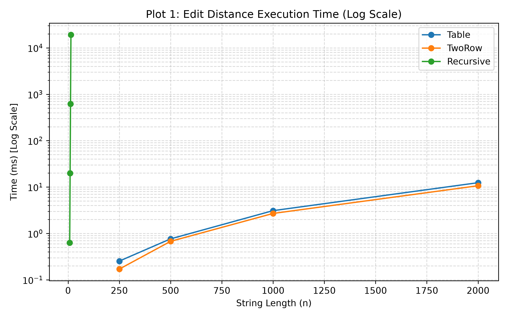
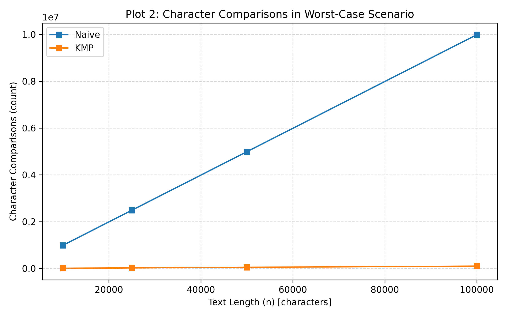
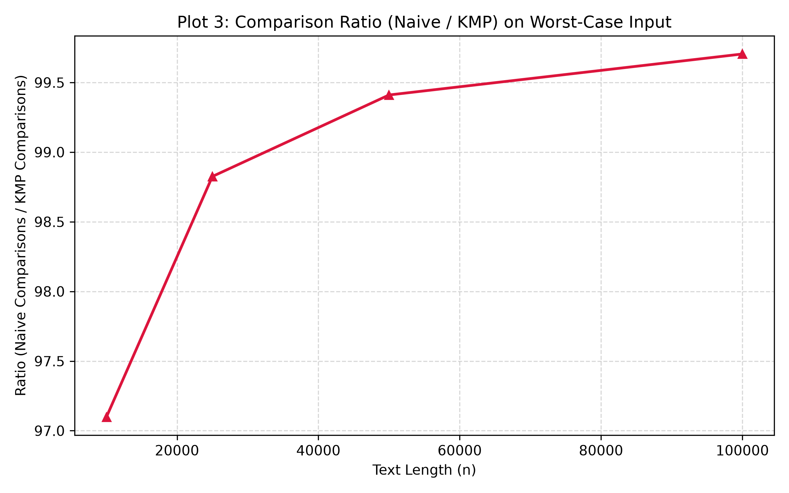

# DAA Assignment 4: Dynamic Programming and String Algorithms Report

## Experiment Design Card

| Card field | What to write |
| :--- | :--- |
| **Question** | 1. DP: Does the table approach scale quadratically $O(n^2)$ while recursion explodes exponentially $O(3^n)$? 2. Strings: Does KMP guarantee strict linear complexity $O(n+m)$ character comparisons on pathological worst-case inputs where Naive degrades to $O(n \cdot m)$? |
| **Sizes (n)** | Edit Distance: Recursive on $n \in \{8, 10, 12, 14\}$; Table and TwoRow on $n \in \{250, 500, 1000, 2000\}$. String Search: Text lengths $n \in \{10000, 25000, 50000, 100000\}$ with pattern length $m = 100$. |
| **Inputs** | 1. Random uniform strings over alphabet $\Sigma = \{A, C, G, T\}$. 2. Worst-case inputs: completely non-matching strings $A^n$ vs $B^n$ for DP; pathological near-matches $T = A^n$ and $P = A^{m-1}B$ for string search to induce maximal backtracking. |
| **Metrics** | 1. DP: Number of state transitions/subproblem evaluations. 2. String Search: Total character comparisons (text-pattern matching + LPS preprocessing). 3. Wall-clock time (median of 5 runs in ms). |
| **Prediction** | Recursive DP will exhibit an explosive exponential growth curve. Table and Two-Row DP will grow quadratically with Two-Row using dramatically less memory cache. Naive string search will perform near $(n \cdot m)$ operations on the pathological pattern, while KMP will remain strictly linear $(\approx n + m)$. |
| **Plots** | 1. `plot1_edit_distance_time.png`: Log-scale execution time comparing Recursive vs Table/TwoRow. 2. `plot2_string_search_worst_case.png`: Total character comparisons vs text size for Naive and KMP on worst-case inputs. 3. `plot3_string_search_ratio.png`: Ratio of Naive to KMP operations verifying $O(m)$ factor acceleration. |

---

## Plots and Results

### Plot 1: Edit Distance Execution Time (Log Scale)

*Takeaway: Recursive DP explodes exponentially even before $n=15$, whereas Table and Two-Row scale smoothly with quadratic order $O(n^2)$.*

### Plot 2: Character Comparisons in Worst-Case Scenario

*Takeaway: Naive search comparisons grow with a steep slope proportional to $n \cdot m$, while KMP retains a gentle, strictly linear slope bounded by $2n$.*

### Plot 3: Comparison Ratio (Naive / KMP)

*Takeaway: The ratio of operations between Naive and KMP matches the pattern length $m=100$, empirically demonstrating the theoretical $O(m)$ speedup factor.*

---

## Prediction vs Result

For Dynamic Programming, predictions matched the empirical findings. The recursive implementation exceeded reasonable computation thresholds past $n=14$, while Table and TwoRow scaled without issues up to $n=2000$. TwoRow demonstrated minor cache-locality advantages over the full table representation.

For String Search, on random text both algorithms behaved linearly due to immediate mismatches on the first character ($O(1)$ average checks). However, on the pathological input ($A^n$ with pattern $A^{99}B$), Naive was forced into $m$ character comparisons at almost every single index, while KMP shifted its pointer via the LPS table without backtracking, completely confirming the linear bound prediction.

---

## Short Answers

**1. Which input made your string search slowest, and why does it do that?**
The pathological input $T = A^n$ and $P = A^{m-1}B$ caused the slowest execution in Naive search. Because 99 out of 100 characters match at every possible start index, Naive evaluates 100 character comparisons before discovering a mismatch at the final pattern character, shifting only by 1 position and re-evaluating, resulting in worst-case $O(n \cdot m)$ work.

**2. How large an n could the recursive Edit Distance handle, and what stopped it?**
The recursive Edit Distance was practically constrained to $n \le 14$. Beyond $n=15$, the recursion tree branches by up to 3 calls per node ($3^n$), creating billions of duplicate subproblem evaluations, leading to combinatorial explosion and thread execution timeouts.

**3. What do you gain and what do you lose when you use two rows instead of the full table?**
Using two rows reduces auxiliary memory from $O(n \cdot m)$ to $O(m)$, preventing JVM OutOfMemory errors and significantly improving CPU L1/L2 cache locality. However, you lose the ability to backtrack through the matrix to reconstruct the optimal sequence of alignment operations (insertions, deletions, substitutions).

**4. If you had to choose one string search for your city platform, which one and why?**
KMP is the optimal choice for log searching and spell-check filtering. While Naive can perform acceptably on random natural text, log files often contain long repetitive traces and error dumps where adversarial or degenerate patterns trigger Naive's $O(n \cdot m)$ degradation; KMP guarantees strict $O(n + m)$ processing regardless of input structure.

---

## One Paragraph on Time

Measured wall-clock time is influenced by JVM warm-up phases, Just-In-Time (JIT) compilation thresholds, and system thread context switching. For small input lengths ($n < 100$), clock times frequently register as 0 ms, which masks differences in asymptotic behavior. By combining median wall-clock durations over 5 runs with explicit hardware-independent algorithmic counters (character comparisons and state iterations), we obtain reproducible and unambiguous validation of theoretical complexity.